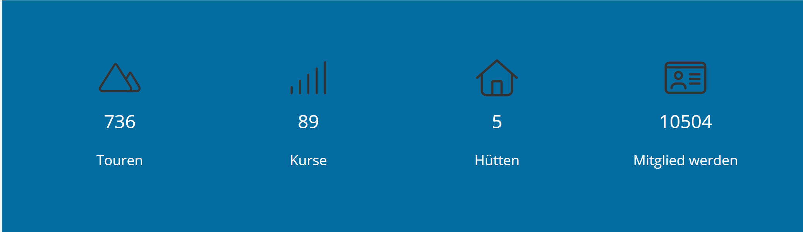
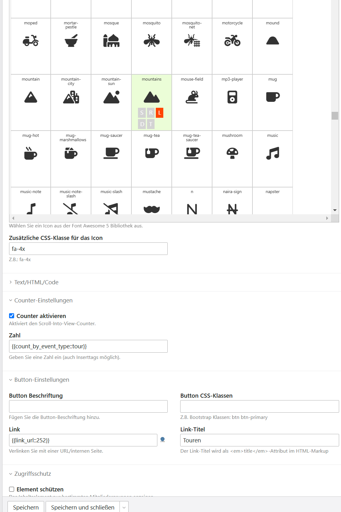

# Contao Service Links

This extension for [Contao CMS](https://contao.org) offers a content element with which service 
links can be placed on your website. [FontAwesome](https://fontawesome.com/) icons can be selected in the backend. 
In addition to the title and the text, a [counter](https://inorganik.github.io/countUp.js) can also be added to your website.

## Requirements

- PHP 8.3 or higher
- Contao 5.3 or Contao 6
- [markocupic/fontawesome-icon-picker-bundle](https://github.com/markocupic/fontawesome-icon-picker-bundle) (Contao 6 requires version 7.1 or higher)

## Backend
